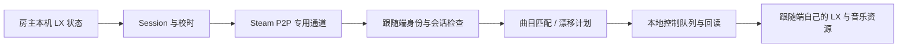

# Steam 歌曲进度同步实验

分支：`experiment/steam-progress-sync`，独立基于正式版 v0.9.5。不会合入网易云实验，也不修改正式 Release。安装包仍只有 bin 和 README，不附加运行时或 Steam DLL。

## 实现范围

- 菜单调用 LX 官方本地 API 播放、暂停、绝对跳转；停止由“暂停 + 跳转到零”组成。
- 每次调用分为队列接收、HTTP 应答、实际状态回读；HTTP 200/OK 不等于播放成功。2 秒内观察不到预期状态就报告未验证。
- Steam P2P 只传输歌名、歌手、时长、进度、播放状态、倍率及协议/校时字段，不发送音乐、歌词全文、下载链接或登录信息。
- 房主单向发布状态，跟随端仅接受配置允许的指定房主。没有主机自动迁移或任意玩家的远程控制。
- 两端各自在自己的 LX 中选同一版本歌曲。歌名/歌手归一化后匹配、时长差不超过 1500ms；不匹配时不控制本机。LX 官方 OpenAPI 没有按歌曲 ID 自动选曲的接口，因此本实验不假设可以自动分发或切换曲目。
- 默认全部关闭；“应用收到的进度”默认关闭。可先观察 DRY RUN 预测漂移，再开启应用。



## 本机控制回调测试

前提：正常安装 L4N、LX 官方桌面版开启 OpenAPI（默认 127.0.0.1:23330），正常歌词模式。其他兼容播放器是否支持写接口需要单独验证。

入口：更多设置 → 落雪控制与 Steam 同步实验 → 落雪 API 控制回调测试。

| 操作 | 端点 | 成功回读 |
| --- | --- | --- |
| 播放 | GET /play | status=playing |
| 暂停 | GET /pause | status=paused |
| 停止 | GET /pause，然后 GET /seek?offset=0.000 | 暂停且进度接近零 |
| 指定进度 | GET /seek?offset=秒数 | 进度接近目标，考虑恢复播放后的自然推进 |

菜单提供 0 秒、30 秒、当前位置后移 10 秒、歌曲中间。开发接口支持任意合法毫秒位置。超过曲目长度、已切歌或断开时不发送无效请求。停止的两个请求之间也重新确认歌曲，避免归零到下一首。

测试时观察“回调”状态及 L4D2DangoMusic.log：`accepted=1` 仅是 API 接收，`verified=1` 才是状态验证成功。线程在后台执行，菜单回调不访问网络；日志包含请求编号和验证结果，不记录歌曲资源地址。

## Steam 单人测试

入口：更多设置 → 落雪控制与 Steam 同步实验 → Steam 自指与本地创建测试。

1. **绑定 / 检查 Steam 接口**：显示真实 SteamID64、所用接口或明确的不支持原因。不会调用 SteamAPI_Init/Shutdown，不读取或处理游戏的 Steam 回调队列。
2. **当前 SteamID 自指收发**：实际调用 Steam SendP2PPacket 向自己发送探测包，只有收到真实 echo 才标 PASS。Steam 拒绝自发或 4 秒无回包会报告 rejected/TIMEOUT；不会用内存模拟冒充成功。
3. **Steam CreateLocalUser 探测**：实际调用 CreateLocalUser，记录返回的用户句柄对应 ID/登录状态，释放自己创建的用户/pipe。它不创建新 Steam 账号，也不保证返回独立在线身份，更不能用作第二个真实玩家的证明。
4. **Steam CreateSocketPair 双端测试**：若游戏提供 SteamNetworkingSockets012，实际创建两个本地连接端点（network loopback），A 发送进度包到 B，检查解码的 30000ms 进度。接口缺失明确标 UNSUPPORTED，失败/超时不算通过。两端是本地虚拟连接，不是新建认证 Steam 玩家。

上述三个真实 Steam 实验不控制音乐。自指成功不证明 NAT/中继/好友链路正常，SocketPair 成功不证明真实跨账号连接正常；双玩家仍需要两个已登录 Steam 账号进行实机测试。

此外菜单提供“虚拟多玩家模拟”，不需要其他 Steam 账号，直接运行纯 C++ 内存传输总线，可创建多个虚拟 Steam-ID 格式端点，注入时钟差、断线、重复、伪造来源和错误歌曲。模拟 ID 仅存在于内存总线，从不发送到真实 Steam 网络。

## 两位玩家联调

1. 两端安装同一个实验包，各自打开 Steam、L4D2、L4N 和提供上述控制 API 的 LX。
2. 两端分别运行“绑定 / 检查 Steam 接口”，记下本机真实 SteamID64。初次可先做上述自指/本地创建测试。
3. 退出游戏，在各自 `bin/neko/plugins/L4D2DangoMusic/config.json` 加入 `steamSync`。ID 必须为十进制字符串，不要写为 JSON 浮点数字。
4. A 的 `role=1`，`peers` 列出 B 的 SteamID64；B 的 `role=2`，`host` 为 A 的 SteamID64，`peers` 至少包含 A。最多允许 8 个对端。`apply` 先保持 false。
5. 重启游戏，两端自己选好同一版本歌曲。共享歌曲进度页应显示握手/校时、收发数量、RTT、预测漂移；不匹配或超时会显示原因。
6. B 确认歌曲匹配后，开启“应用收到的进度”。A 测试暂停、播放、拖动进度和停止，观察 B 的控制回读。保存设置可保留角色、允许列表、房主和开关。

初始配置模板（默认关闭）：

```json
"steamSync": {
  "role": 0,
  "apply": false,
  "thresholdMs": 350,
  "host": "",
  "peers": []
}
```

role：0 关闭，1 房主，2 跟随者。请把上面步骤得到的真实 ID 填入允许列表。房主/允许列表在配置文件设置，当前没有好友邀请/自动发现或文本输入菜单。

房主每 500ms 发布状态；双向校时每 2 秒一次，使用四时间戳估计时钟差和往返延迟，不把两台电脑的 uptime 当成同一时钟。跟随端默认漂移超过 350ms 才跳转，校正操作间隔至少 1200ms；菜单可选 150/350/700ms。暂停/恢复按状态变化执行，不重复 toggle。

校时超过 15 秒无有效样本、状态超过 3 秒无有效更新，或房主失联时停止自动控制。6 秒无房主消息会重新握手；不会自行选择陌生新房主，也不会在断线时强制暂停本机。播放倍率不一致时要求用户自行设成相同倍率，不悄悄修改速度。这里对齐的是播放器进度，不是音频采样时钟；声卡、蓝牙及各客户端的缓冲延迟仍可能不同。

## 开发与复用

见 [模块 API](api.md) 和 [接口契约 / 测试记录](validation.md)。配置中的角色与远端应用均默认关闭；原有普通歌词、世界/挂画和实体跟随逻辑继续使用本机 LX 的状态。

```bash
bash scripts/test.sh
DANGO_CXX=i686-w64-mingw32-g++-posix bash scripts/build-mingw.sh
python3 scripts/package.py --variant steam-sync
```

Windows x86 MSVC：scripts/build.ps1 同时构建并运行 Steam ABI mock 和协议测试。Steam 游戏接口本身的测试必须在已登录 Steam 的实际游戏内运行；云端交叉编译不能代替这一部分。
